<picture>
  <source media="(prefers-color-scheme: dark)" srcset="Assets/banner-dark.svg">
  <source media="(prefers-color-scheme: light)" srcset="Assets/banner-light.svg">
  
</picture>

I build full-stack web apps, ecommerce stores and AI systems. I use React, TypeScript and Postgres for apps and Shopify for commerce. I founded **Inbox Ecommerce** and **Agentive Labs**, and I've built 25+ stores for 37+ clients across the USA, UAE, Singapore and Pakistan.

[Website](https://rummanhassan.cv) · [Case studies](https://rummanhassan.cv/work) · [LinkedIn](https://www.linkedin.com/in/rummanhassan13) · [Email](mailto:connect@rummanhassan.dev) · [Book a call](https://cal.com/rummanbuilds/connect)

## Selected work

### Arslan Transport 2.0 &nbsp;·&nbsp; [live](https://arslan-transport-2-0.vercel.app) · [code](https://github.com/rummanhassan13/arslan-transport-2.0)
A multi-tenant operations platform for a transport company, running as a pilot with real data. It covers shipments, automatic invoicing, driver ledgers, company receivables, expenses and reporting.
- A Postgres function creates each shipment together with its invoice and driver advances in one transaction, so balances and ledgers stay consistent.
- Data is scoped per organization with Row Level Security. Shipment documents are stored privately in Cloudflare R2 and opened through signed, time-limited links.
- It has domain unit tests, database tests and Playwright end-to-end smoke tests, plus a demo mode that runs entirely in the browser.

`TypeScript` `React` `Supabase` `Postgres` `Edge Functions` `Cloudflare R2` `Vitest` `Playwright`

### Thaal &nbsp;·&nbsp; [live](https://thaal.lovable.app) · [code](https://github.com/rummanhassan13/thaal)
QR menus and table ordering for restaurants. Owners build their menu and print a QR code for each table. Guests order from their phone without an account and follow the order status live.
- Guests never read order tables directly. Server-side functions check a tracking token for each order.
- Only the service role can write billing and plan fields, so users can't upgrade themselves.
- The cart, opening hours, scheduling, QR and plan logic all have unit tests.

`TypeScript` `React` `TanStack Start` `Supabase` `Realtime` `Vitest`

### Blob Gang &nbsp;·&nbsp; [live](https://blobgang.lovable.app) · [code](https://github.com/rummanhassan13/blobgang)
A multiplayer typing race where players race as jelly-blob characters. It has shareable rooms, a solo mode against a ghost of your previous run, and leaderboards.
- Results are calculated on the server. Clients can't write their own results or change room state.
- Input is limited to one character per keystroke, so pasting text doesn't work.
- Race progress syncs live between players over a Supabase Realtime channel.

`TypeScript` `React` `TanStack Start` `Supabase Realtime` `Postgres` `Vitest`

> Most of my client work is in private repositories. You can read the write-ups at [rummanhassan.cv/work](https://rummanhassan.cv/work).

## Now building

**[AI Systems Lab](https://github.com/rummanhassan13/ai-systems-lab)** is a public workspace for small, reproducible AI experiments covering RAG, function calling, lightweight agents, evaluation and safety. The methodology and report template are published. The experiments are planned on the [project board](https://github.com/users/rummanhassan13/projects/1) and each one goes into the repo only once it has code and a verified write-up.

## Stack

| Area | Tools |
| :-- | :-- |
| **Apps** | TypeScript · React · TanStack Start · Vite · Tailwind CSS |
| **Data & backend** | Supabase · Postgres (RLS, SQL functions) · Edge Functions · Cloudflare R2 |
| **Quality** | Vitest · Testing Library · Playwright · ESLint |
| **Commerce** | Shopify · Shopify Plus · Liquid · WooCommerce · WordPress · Klaviyo |
| **AI & automation** | Claude API · OpenAI API · function calling · RAG · n8n · Make · WhatsApp Business API |

## How I build

- I enforce business rules in the database and on the server, not in the browser.
- I ship the smallest useful version first, then improve it based on real usage.
- I test the code that handles money, state and permissions.
- I use AI tools (Claude Code, Codex, Lovable) to build faster. I own the architecture, the data model and the code review.
- I document everything so the client's team can run it without me.

---

Lahore, Pakistan · [rummanhassan.cv](https://rummanhassan.cv)
